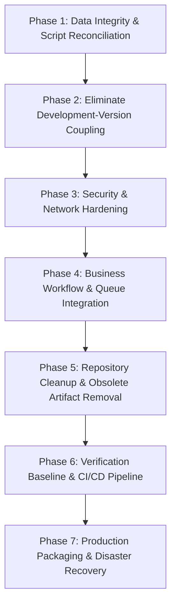

# AEVORA — Production Transformation Implementation Plan

**Workspace:** `E:\Aevora`  
**Plan Date:** 2026-10-12  
**Target State:** Clean, Decoupled, Secure, Hardened, Multi-Tenant Production Product  
**Status:** PROPOSED — PENDING EXPLICIT USER APPROVAL (Stage 1 Audit Complete)  

---

## 1. Guiding Principles & Invariants

1. **No Data Loss:** Preserve `docker_postgres_data` volume and never touch the unrelated `hostel-postgres` container on port 5432.
2. **Preserve Migration History:** Do not rename, modify, or delete any migration in `packages/database/prisma/migrations/`.
3. **Zero Milestone Coupling in Finished Product:** Completely eliminate milestone identifiers (`v10`–`v24`, `slice1`–`slice10`) from runtime modules, controllers, routes, types, UI text, and test filenames.
4. **Test-Driven Progression:** Every phase must pass full typecheck, test suites, and build verification before proceeding to the next.
5. **Fail-Closed Security:** Security boundaries must enforce explicit company context, authenticated tokens, cryptographic approval bindings, and fail-closed emergency stops.

---

## 2. Phased Implementation Roadmap

---

### Phase 1: Data Integrity & Script Reconciliation

**Goal:** Fix broken repository scripts, secure local database connection defaults, and ensure uninterrupted database access.

#### Actions:
1. **Reconcile Root `package.json` Database Scripts:**
   - Replace deleted script references:
     - `"db:migrate": "npx prisma migrate deploy --schema=packages/database/prisma/schema.prisma"`
     - `"db:local:setup": "npm run db:migrate && npm run db:seed"`
2. **Lock Database Port Convention in Configuration:**
   - Standardize `.env.example` and local `.env` so `DATABASE_URL` defaults to `localhost:5433` (the dedicated Aevora container port) while preserving override capability via `POSTGRES_PORT`.
3. **Verify Migration Status:**
   - Execute `npx prisma migrate status --schema=packages/database/prisma/schema.prisma` to confirm 68/68 migrations applied cleanly on port 5433.

#### Verification Gate:
- `npm run db:migrate` runs without errors.
- `npx prisma migrate status` outputs `Database is up to date`.

---

### Phase 2: Elimination of Development-Version Coupling

**Goal:** Remove all development milestone numbers (`v10`–`v24`, `slice*`) from runtime code, API routing, shared libraries, UI components, and test filenames.

#### Actions:

##### 2.1 Spatial Module & Controllers Refactoring
- Rename directory `apps/api/src/v12-spatial/` to `apps/api/src/spatial/`.
- Rename service classes and files:
  - `V12SpatialService` (`v12-spatial.service.ts`) → `SpatialService` (`spatial.service.ts`)
  - `V12NavigationService` (`v12-navigation.service.ts`) → `SpatialNavigationService` (`spatial-navigation.service.ts`)
  - `V12VehicleService` (`v12-vehicle.service.ts`) → `VehicleService` (`vehicle.service.ts`)
  - `V12CommandAdapter` (`v12-command.adapter.ts`) → `SpatialCommandAdapter` (`spatial-command.adapter.ts`)
  - `V12AssistantAdapter` (`v12-assistant.adapter.ts`) → `SpatialAssistantAdapter` (`spatial-assistant.adapter.ts`)
  - `V12VRActionAdapter` (`v12-vr-action.adapter.ts`) → `VRActionAdapter` (`vr-action.adapter.ts`)
  - `V12SpatialAudioService` (`v12-spatial-audio.service.ts`) → `SpatialAudioService` (`spatial-audio.service.ts`)
  - `V12SpatialModule` (`v12-spatial.module.ts`) → `SpatialModule` (`spatial.module.ts`)
- Normalize HTTP Controller Routes:
  - `@Controller('v12-command')` → `@Controller('spatial/command')`
  - `@Controller('v12-assistant')` → `@Controller('spatial/assistant')`
  - `@Controller('v12-capacity')` → `@Controller('spatial/capacity')`
  - `@Controller('v12-vehicles')` → `@Controller('spatial/vehicles')`
  - `@Controller('v12-vr-action')` → `@Controller('spatial/vr-action')`
  - `@Controller('v12-spatial-audio')` → `@Controller('spatial/audio')`
  *(Note: Retain backward-compatible secondary route paths if external clients require them).*

##### 2.2 Shared Package Spatial Domain Refactoring
- Relocate `packages/shared/src/v12/` to `packages/shared/src/spatial/`.
- Introduce canonical type aliases:
  - `export type SpatialEntityType = V12EntityType;` (then migrate to `SpatialEntityType`)
  - `export type SpatialEntityId = string;`
  - `export type SpatialIntentType = V12IntentType;`
- Update `packages/shared/src/index.ts` to export from `./spatial`. Provide legacy re-export from `./v12` during transition.

##### 2.3 Frontend & BFF Route Decoupling
- Rename `apps/web/src/components/executive/V15SpatialContextBadge.tsx` to `SpatialContextBadge.tsx`.
- Update badge text from `"V15 3D DIGITAL-TWIN"` to `"3D DIGITAL TWIN"`.
- Update `ExternalActionGatewayConsole.tsx`:
  - Change `"V24 OFFER ENGINE"` to `"OFFER ENGINE"`.
  - Normalize provider string `AEVORA_V24_OFFER_MARKET_ADAPTER` to `AEVORA_OFFER_MARKET_ADAPTER`.
- Normalize BFF routes in `apps/web/src/app/api/bff/executive/[...slug]/route.ts`:
  - `v15-context` → `spatial-context` (with fallback for legacy)
  - `v24-context` → `offer-context` (with fallback for legacy)
- Update `apps/web/src/lib/executive-types.ts`:
  - `V15SpatialContext` → `SpatialContext`
  - `V24OfferContext` → `OfferContext`

##### 2.4 Environment Variables Normalization
- In `apps/api/src/spatial/spatial.service.ts`, accept canonical environment variables with legacy fallbacks:
  - `SPATIAL_HISTORY_RETENTION_DAYS ?? process.env.V12_SPATIAL_HISTORY_RETENTION_DAYS ?? 30`
- Update `.env.example` to document clean canonical keys.

##### 2.5 Test Suite Filename Normalization
- Rename 40+ test files according to the mapping catalog in `AEVORA_REPOSITORY_CLEANUP_INVENTORY.md` Section 4.
- Verify all 130+ backend tests and 420 frontend tests pass under their canonical filenames.

#### Verification Gate:
- `npx turbo run build` passes with exit code 0.
- `npm run test` in `apps/web` (420 passed).
- `npm run test` in `packages/shared` (144 passed).
- All renamed backend test suites pass with zero regressions.

---

### Phase 3: Security & Network Hardening

**Goal:** Seal network boundaries, secure Redis and PostgreSQL against unauthorized host access, implement API rate limiting, and establish reverse proxy / WAF controls.

#### Actions:
1. **Docker Host Port Binding Isolation:**
   - Update `infrastructure/docker/docker-compose.yml`:
     - Bind PostgreSQL to localhost: `127.0.0.1:${POSTGRES_PORT:-5433}:5432`
     - Bind Redis to localhost: `127.0.0.1:6379:6379`
   - Prevent external exposure on multi-homed or public-IP hosts.
2. **Redis Password Protection:**
   - Add `requirepass ${REDIS_PASSWORD:-aevorasecret}` to Redis container startup in `docker-compose.yml`.
   - Update `REDIS_URL` in `.env` to include password: `redis://:aevorasecret@localhost:6379`.
3. **Application-Level HTTP Rate Limiting:**
   - Install `@nestjs/throttler` in `apps/api`.
   - Configure global rate limiting in `app.module.ts`:
     - Default tier: 100 requests per minute per IP.
     - Auth tier (`/auth/login`): 10 requests per minute per IP.
4. **Content Security Policy (CSP) & Security Headers:**
   - Enhance Helmet configuration in `apps/api/src/main.ts` with explicit CSP rules.
   - Configure Next.js security headers in `apps/web/next.config.ts` (HSTS, X-Frame-Options, X-Content-Type-Options).
5. **Reverse Proxy Configuration (Production Blueprint):**
   - Provide production Nginx / Caddy reverse proxy template in `infrastructure/nginx/aevora.conf` providing TLS termination, request throttling, and routing for `:3000` (web) and `:13000` (api).

#### Verification Gate:
- Port inspection confirms PostgreSQL and Redis listening exclusively on `127.0.0.1`.
- Rapid requests to `/api/auth/login` trigger HTTP 429 Too Many Requests.
- Full build and test suites pass.

---

### Phase 4: Business Workflow Integrity & Production Integration

**Goal:** Ensure all 8 core business workflows operate seamlessly, durably, and safely.

#### Actions:
1. **Durable Worker Scheduling:**
   - Verify task retry loop and background job persistence in PostgreSQL.
   - Document Redis queue deployment architecture for multi-instance scaling.
2. **Sovereign Governance & Emergency Stop Verification:**
   - Add prominent Emergency Stop status indicator and toggle in Chairman header navigation in `apps/web`.
   - Verify fail-closed behavior across all mutation endpoints when active.
3. **Outbound Sandbox Guard Hardening:**
   - Ensure `ENABLE_REAL_PRODUCTION_SENDING` defaults to `false`.
   - Validate that external marketing and sales outreach cannot inadvertently dispatch real communications in development or staging.

#### Verification Gate:
- Execute `OfferMarket` and `TaskExecution` integration tests against PostgreSQL.
- Verify emergency stop halts state changes in web UI and backend API.

---

### Phase 5: Repository Cleanup & Obsolete Artifact Removal

**Goal:** Purge confirmed dead code, scratch scripts, and reconcile Git status.

#### Actions:
1. **Remove Verified Dead Code:**
   - Delete `apps/api/src/v10-test.ts`.
   - Delete `apps/api/src/lead-generation/` (abandoned stub).
2. **Archive Historical Reports:**
   - Move past milestone markdown reports to `docs/historical/` or reconcile working tree deletions cleanly in Git.
   - Keep only canonical documentation at repository root:
     - `README.md`
     - `ROADMAP.md`
     - `SETUP.md`
     - `AEVORA_PRODUCTION_READINESS_AUDIT.md`
     - `AEVORA_REPOSITORY_CLEANUP_INVENTORY.md`
     - `AEVORA_END_TO_END_ACCEPTANCE_MATRIX.md`
     - `AEVORA_IMPLEMENTATION_PLAN.md`

#### Verification Gate:
- `git status` shows clean, intentional tracked state.
- `npx turbo run build` passes with exit code 0.

---

### Phase 6: Automated Testing Baseline & CI/CD Pipeline

**Goal:** Provide single-command verification for the entire platform.

#### Actions:
1. **Root Verification Script:**
   - Add `"test:all"` script in root `package.json`:
     `"test:all": "turbo run test && npm run test --workspace=@aevora/web"`
2. **CI Pipeline Configuration:**
   - Create GitHub Actions workflow (`.github/workflows/ci.yml`) validating:
     - Typecheck across all packages.
     - Linting.
     - Unit & integration tests.
     - Monorepo production build.

#### Verification Gate:
- Running `npm run test:all` executes all unit, integration, and component tests across all 5 packages with 0 failures.

---

### Phase 7: Production Packaging & Disaster Recovery

**Goal:** Create production-ready container definitions and disaster recovery automation.

#### Actions:
1. **Production Dockerfiles:**
   - Create multi-stage `Dockerfile.api` (compiles NestJS to standalone production Node bundle).
   - Create multi-stage `Dockerfile.web` (Next.js standalone output).
2. **Production Docker Compose:**
   - Create `infrastructure/docker/docker-compose.prod.yml` coordinating Web, API, Postgres, Redis, and Reverse Proxy with healthchecks and restart policies.
3. **Automated Backup Restoration Script:**
   - Create `infrastructure/scripts/restore-db.sh` to complement `backup-db.sh`.
   - Validate backup restoration against a temporary test container.

#### Verification Gate:
- Container builds succeed.
- Backup creation and restoration test succeeds without data loss.

---

## 3. Mandatory Stop Condition & Authorization Gate

**STATUS: AUDIT AND IMPLEMENTATION PLAN COMPLETE.**

In compliance with the mandatory stop condition:
- Zero destructive commands have been executed.
- Zero code files have been altered or deleted.
- Zero database schemas or contents have been changed.
- Zero firewall rules have been installed.
- Zero deployments or real external transactions have been triggered.

### Request for Explicit User Approval:
Awaiting user confirmation to proceed with **Phase 1 (Data Integrity & Script Reconciliation)** and **Phase 2 (Elimination of Development-Version Coupling)** of this plan.
