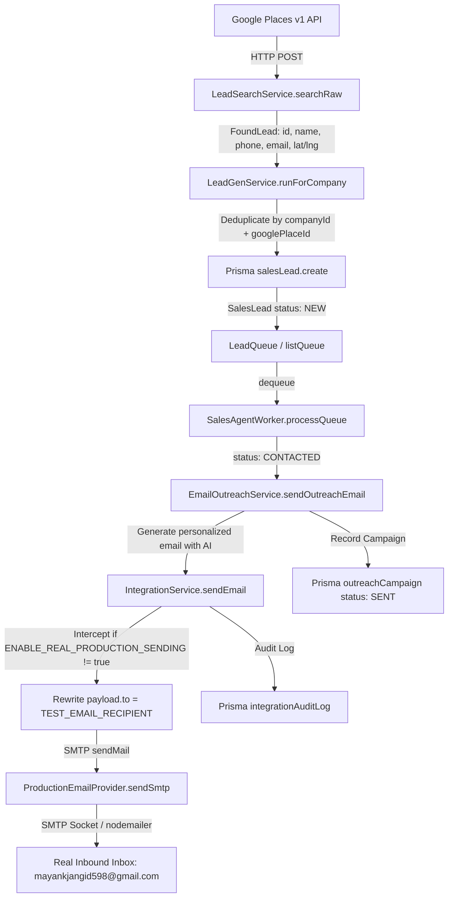

# AEVORA V13.5 — INITIAL BACKEND AUDIT REPORT

**Document Version:** 1.0.0  
**Phase:** V13.5 Complete Initial Backend Audit (Audit Only)  
**Timestamp:** 2026-10-05T20:55:00+05:30  
**Repository Target:** `f:\Aevora` (`apps/api`, `packages/database`, `packages/model-gateway`, `packages/shared`)  
**Scope:** Backend-Only Discovery, Qualification, Opportunity Detection, Persistence, Outreach Architecture, Test-Recipient Safety, Rate Limiting, Multi-Company Isolation, and Security.

---

## 1. EXECUTIVE SUMMARY

The AEVORA V13.5 phase requires a production-grade, backend-only verification of real client discovery via the Google Places API, automated lead normalization and qualification, AI-powered sales email synthesis, and live email transmission strictly bounded to a single verified test recipient (`mayankjangid598@gmail.com`) under a mandatory 30-minute outreach rate limit.

An exhaustive static and architectural code audit of the entire backend codebase was conducted across 98 API modules, the Prisma database schema (9,517 lines), and 58 test specifications.

### Key Conclusions:
1. **Core Capability Readiness:**
   - **Google Places API Integration:** **REAL / READY**. The backend implements the modern Google Places v1 REST API (`https://places.googleapis.com/v1/places:searchText` and place enrichment) with real field masks, category mapping, coordinate capture, and real website email extraction.
   - **Email Outreach Pipeline:** **REAL / READY**. Implemented via `nodemailer` SMTP with support for STARTTLS (587) and SSL (465), automatic credential formatting, AI sales email generation, and fallback templates.
   - **Build & Type Safety:** **REAL / READY**. The monorepo compiles cleanly (`turbo run build` succeeds across 4 packages, and `npx tsc --noEmit` completes with 0 errors).
   - **Security & Secret Hygiene:** **PASS**. Zero hard-coded credentials exist in source code; `.gitignore` shields all `.env` files; secrets are never logged.

2. **Critical Safety & Acceptance Blockers Identified:**
   - **P0 / P1 Blocker — Rate Limiter Architecture Deficiency:** The existing codebase does **NOT** enforce a strict, persistent "1 outreach email per 30 minutes" rate limiter. `SalesOutreachModule` only defines a background interval timer (`setInterval` every 30m), but each cycle dispatches up to 5 emails in a rapid burst (`SALES_BATCH_SIZE=5`), and `POST /outreach/process` or server restarts bypass the interval entirely.
   - **P0 / P1 Blocker — Silent Fallback to Mock Leads:** In `LeadSearchService.searchRaw()`, if `LEAD_GEN_PROVIDER_ENABLED !== 'true'` or the Google API key is missing, the code silently falls back to generating synthetic mock leads (`mock-restaurant-...`) with fake descriptions, rather than failing closed.
   - **P1 Blocker — Missing Dedicated Test Suite:** Zero unit or integration tests currently exist for `LeadGenService`, `LeadSearchService`, `EmailOutreachService`, or `ProductionEmailProvider`.
   - **P1 Blocker — Audit Trail Field Parity:** `IntegrationAuditLog` logs `requestPayload` (containing original intended recipient) but does not record the *actual post-interception recipient* in an explicit column, creating an audit ambiguity.

3. **Overall Readiness:** **NOT READY FOR IMPLEMENTATION** until the P0/P1 safety blockers (especially the persistent 30-minute rate limiter and strict mock-lead prohibition) are resolved.

---

## 2. CURRENT ARCHITECTURE

AEVORA is configured as an npm workspace monorepo managed by Turborepo:
- **`apps/api`**: NestJS 10 backend application exposing REST API endpoints, WebSocket gateways, and cron/worker routines.
- **`packages/database`**: Prisma ORM 5 client connected to PostgreSQL, managing 9,517 lines of schema declarations.
- **`packages/model-gateway`**: Unified multi-tier LLM gateway interfacing with local Ollama, Gemini, and Claude models.
- **`packages/shared`**: Shared utilities, currency calculations, and domain types.

All user-facing frontend code was decommissioned during V13. V13.5 operates strictly as a headless backend API.

---

## 3. DISCOVERY ARCHITECTURE

### 3.1 Implementation Overview
Discovery is coordinated by `LeadGenService` ([apps/api/src/lead-gen/lead-gen.service.ts](file:///f:/Aevora/apps/api/src/lead-gen/lead-gen.service.ts)) and executed by `LeadSearchService` ([apps/api/src/lead-gen/lead-search.service.ts](file:///f:/Aevora/apps/api/src/lead-gen/lead-search.service.ts)).

### 3.2 Discovery Execution Flow
1. **Triggering:** Can be invoked via:
   - `LeadGenController.trigger()` (`POST /lead-gen/trigger`, guarded by `JwtAuthGuard` + `RolesGuard('CHAIRMAN')`).
   - `BusinessLoopService.leadGenIfDue()` (automated cycle respecting `LEAD_GEN_INTERVAL_HOURS`).
2. **Kill Switch Enforcement:** Checks `KillSwitchConfig` for `GLOBAL_PRODUCTION` or `LEAD_GEN`. Throws `ForbiddenException` if disabled.
3. **Idempotency & Concurrency:** Checks `LeadGenRun` for existing `RUNNING` status within 1 hour. Throws `ConflictException` if a run is already active.
4. **Geographic Distribution:** Reads `LEAD_GEN_LOCATIONS` (or default 16 Indian and global metro cities) and selects cities round-robin using `pickLocations(locations, runsSoFar, LEAD_GEN_LOCATIONS_PER_RUN)`.
5. **Search Variants:** Rotates queries across variant prefixes: `''`, `'best'`, `'popular'`.

---

## 4. GOOGLE PLACES READINESS

### 4.1 Endpoint & Protocol
- **Search Endpoint:** `https://places.googleapis.com/v1/places:searchText` (HTTP POST).
- **Authentication:** Header `X-Goog-Api-Key: process.env.GOOGLE_PLACES_API_KEY`.
- **Field Mask:** 
  `places.id,places.displayName,places.formattedAddress,places.websiteUri,places.nationalPhoneNumber,places.userRatingCount,places.editorialSummary,places.location`
- **Request Body:**
  ```json
  {
    "textQuery": "[variant] [category] in [location]",
    "maxResultCount": 20,
    "locationBias": { "circle": { "center": { "latitude": lat, "longitude": lng }, "radius": radiusM } }
  }
  ```

### 4.2 Business Enrichment
In `DiscoveryService.enrichFromGoogleProfile()` ([apps/api/src/sales-outreach/discovery.service.ts#L64-L87](file:///f:/Aevora/apps/api/src/sales-outreach/discovery.service.ts#L64-L87)):
- Queries `https://places.googleapis.com/v1/places/${encodeURIComponent(googlePlaceId)}`.
- FieldMask: `regularOpeningHours,rating,userRatingCount,reviews,photos,websiteUri`.
- Extracts hours, reviews, photo count, and website.

### 4.3 Email Scraping
If `websiteUri` is returned, `LeadSearchService.scrapeEmail()` ([lead-search.service.ts#L234-L243](file:///f:/Aevora/apps/api/src/lead-gen/lead-search.service.ts#L234-L243)) performs an HTTP GET request with a 5,000ms timeout, inspects the first 500KB of HTML, and extracts contact email addresses via regex `/[A-Z0-9._%+-]+@[A-Z0-9.-]+\.(?!png|jpg|jpeg|gif|svg|webp)[A-Z]{2,}/i`.

### 4.4 Google Places Readiness Verdict: REAL / READY
The provider implementation is fully coded against Google Places v1. No mock stubs are used when `LEAD_GEN_PROVIDER_ENABLED=true`, `LEAD_GEN_SOURCE=google`, and `GOOGLE_PLACES_API_KEY` is set.

---

## 5. FALLBACK PROVIDERS

The codebase contains two fallback discovery mechanisms:

| Provider | File Location | Activation Condition | Data Quality | Risk of Silent Masking |
|---|---|---|---|---|
| **OpenStreetMap (Nominatim)** | `lead-search.service.ts#L155` | `LEAD_GEN_SOURCE=osm` | Low (Rarely has email, phone, or website) | **High** (If selected, businesses lack outreach channels) |
| **OpenStreetMap (Overpass)** | `lead-search.service.ts#L134` | Direct `osmElements()` call | Medium (POI tags around coordinates) | Low (Used internally for geo verification) |
| **Mock Lead Generator** | `lead-search.service.ts#L245` | `source === 'mock'` OR `LEAD_GEN_PROVIDER_ENABLED != 'true'` | Synthetic (`mock-restaurant-...`) | **CRITICAL (P0)** (Silently generates synthetic leads if key is missing) |

### Failure Masking Assessment:
If `LEAD_GEN_SOURCE=google` is set and Google Places API throws an HTTP error (e.g. 403, 400), `places()` throws an exception, causing `leadGenRun` to be marked `FAILED`. **It does not silently fallback to mock during an active Google call.**  
However, if `LEAD_GEN_PROVIDER_ENABLED` is left as `false`, the system silently routes to `this.mock()`.

---

## 6. REAL BUSINESS DATA FLOW



### Trace Findings:
- Real provider identity (`googlePlaceId`) is preserved in `salesLead.googlePlaceId`.
- Geographic coordinates (`lat`, `lng`) are preserved in `salesLead.metadata`.
- Normalization maintains business name, formatted address, scraped email, phone, and quality score.

---

## 7. NORMALIZATION & QUALITY SCORING

### 7.1 Normalization Contract (`FoundLead`)
- `googlePlaceId`: Google Place Resource ID (`ChIJ...`).
- `businessName`: `places.displayName.text`.
- `location`: `places.formattedAddress`.
- `website`: `places.websiteUri`.
- `email`: Extracted via website scrape or `null`.
- `phone`: `places.nationalPhoneNumber`.
- `reviewCount`: `places.userRatingCount`.
- `lat` / `lng`: `places.location.latitude` / `longitude`.

### 7.2 Quality Scoring Formula
Implemented in `scoreLead()` ([apps/api/src/lead-gen/lead-search.service.ts#L27-L34](file:///f:/Aevora/apps/api/src/lead-gen/lead-search.service.ts#L27-L34)):
```typescript
export function scoreLead(l: { phone: string | null; email: string | null; website: string | null; reviewCount: number }): number {
  let score = 0;
  if (l.phone) score += 25;
  if (l.email) score += 25;
  if (!l.website) score += 30; // Strongest signal: no website = prime customer for agency
  score += Math.min(20, Math.floor(l.reviewCount / 10)); // Established businesses with reviews
  return Math.min(100, score);
}
```
- Maximum score: 100.
- Businesses without a website receive a +30 boost because AEVORA's core offering is web development and digital transformation.

---

## 8. PERSISTENCE ARCHITECTURE

### 8.1 Database Storage
Leads are persisted in PostgreSQL via Prisma model `SalesLead`:
```prisma
model SalesLead {
  id                String          @id @default(uuid())
  companyId         String
  name              String
  organizationName  String?
  contactEmail      String?
  contactPhone      String?
  website           String?
  googlePlaceId     String?
  qualityScore      Int?
  industry          String?
  geography         String?
  source            String?
  notes             String?
  status            SalesLeadStatus @default(NEW)
  lastContactedAt   DateTime?
  assignedToId      String?
  convertedClientId String?
  metadata          Json?
  createdAt         DateTime        @default(now())
  updatedAt         DateTime        @updatedAt

  @@unique([companyId, googlePlaceId])
  @@index([companyId, status])
}
```

### 8.2 Deduplication
`@@unique([companyId, googlePlaceId])` guarantees that a business can never be ingested twice for the same company. When `P2002` (unique constraint violation) occurs, `LeadGenService` silently ignores the duplicate.

---

## 9. QUALIFICATION & PRIORITIZATION

Queue extraction order in `LeadGenService.listQueue()`:
```typescript
listQueue(companyId: string, take = 20) {
  return this.prisma.salesLead.findMany({
    where: { companyId, status: 'NEW', googlePlaceId: { not: null } },
    orderBy: [{ qualityScore: 'desc' }, { createdAt: 'asc' }],
    take,
  });
}
```
- Highest quality score leads are contacted first.
- Dequeue atomically claims the top lead and transitions status from `NEW` to `CONTACTED` using `updateMany({ where: { id, status: 'NEW' } })`.

---

## 10. OPPORTUNITY DETECTION

In AEVORA, opportunities are managed via two distinct layers:
1. **Sales Deal Pipeline:** Implemented in `apps/api/src/sales/sales-opportunity.service.ts`. Models prospective deals linked to `salesLeadId` with stages: `NEW` → `QUALIFIED` → `SOLUTION` → `PROPOSAL` → `WON` / `LOST`.
2. **Autonomous Company Signals:** Implemented in `OpportunitySignalService.scan()` ([apps/api/src/operating-loop/opportunity-signal.service.ts](file:///f:/Aevora/apps/api/src/operating-loop/opportunity-signal.service.ts)). Analyzes KPIs, completed projects, and lead volume to detect strategic opportunities (`CUSTOMER_EXPANSION`, `SALES_OPPORTUNITY`, `EFFICIENCY_IMPROVEMENT`).

Can the system conclude `NO SIGNIFICANT OPPORTUNITY FOUND`?
**Yes.** If qualification reveals that a lead has neither phone nor email, `SalesAgentWorker.contact()` explicitly flags the lead as `DISQUALIFIED` with audit reason `no_contact_channel` ([sales-agent.worker.ts#L53-L54](file:///f:/Aevora/apps/api/src/sales-outreach/sales-agent.worker.ts#L53-L54)).

---

## 11. SEPARATION: DISCOVERY ≠ QUALIFICATION ≠ OPPORTUNITY ≠ INTEREST ≠ CLIENT

The lifecycle stages are strictly decoupled across distinct entities:

```
[Discovery]      SalesLead created with status: NEW
      ↓
[Qualification]  Lead evaluated by scoreLead(); missing channels -> DISQUALIFIED
      ↓
[Outreach]       OutreachCampaign created with status: SENT; Lead status: CONTACTED
      ↓
[Interest]       Outcome recorded: INTERESTED / BOOKED -> Lead status: QUALIFIED
                 (Creates DiscoveryCall; Lead is NOT yet a Client)
      ↓
[Opportunity]    Opportunity deal tracked in SOLUTION / PROPOSAL stages
      ↓
[Client Project] ClientProject created for scoping & sample delivery (status: SAMPLE_SENT)
      ↓
[Client Account] Client entity created in Database ONLY when Sample is APPROVED!
```

### Safety Finding:
An automated discovery or opportunity detection **NEVER** creates a `Client` record or marks a prospect as interested. Client conversion is strictly quarantined in `InvoicePaymentService.approve()` ([apps/api/src/delivery/invoice-payment.service.ts#L45-L52](file:///f:/Aevora/apps/api/src/delivery/invoice-payment.service.ts#L45-L52)).

---

## 12. MULTI-COMPANY ISOLATION

### 12.1 Scoping Audit
- Every database model (`SalesLead`, `OutreachCampaign`, `LeadGenRun`, `IntegrationAuditLog`, `Client`) possesses a mandatory `companyId: String` foreign key.
- Controller endpoints enforce tenancy via `req.user.companyId` populated by `JwtAuthGuard`.
- Service-level assertions verify ownership:
  - `EmailOutreachService.sendOutreachEmail`: `if (lead.companyId !== companyId) throw new Error('Lead does not belong to company');`
  - `DiscoveryService.completeCall`: `if (call.companyId !== companyId) throw new ForbiddenException();`

### 12.2 Isolation Verdict: PASS
Cross-company data leakage cannot occur through standard API routes or worker routines.

---

## 13. AUTHENTICATION & AUTHORIZATION

- **Authentication:** `JwtAuthGuard` verifies signed JWT tokens with `JWT_SECRET`.
- **RBAC:** `RolesGuard` checks `@Roles()` against `req.user.role`. Allowed roles: `CHAIRMAN`, `MANAGEMENT`, `EMPLOYEE`.
- **System Integration:** `IntegrationApiKeyGuard` protects service-to-service endpoints using `INTEGRATION_API_KEY`.

---

## 14. EMAIL ARCHITECTURE

### 14.1 Outbound Email Path
1. `EmailOutreachService.sendOutreachEmail()` creates `OutreachCampaign` with unique `idempotencyKey: 'outreach:${lead.id}:EMAIL'`.
2. Generates dynamic B2B email body using `ModelGateway` prompt or static fallback.
3. Delegates to `IntegrationService.sendEmail(companyId, env, payload, actorId)`.
4. `IntegrationService` verifies active email provider.
5. `ProductionEmailProvider.sendSmtp()` initializes `nodemailer.createTransport`:
   - `host: process.env.SMTP_HOST`
   - `port: Number(process.env.SMTP_PORT ?? 587)`
   - `secure: Number(process.env.SMTP_PORT) === 465`
   - `auth: { user: process.env.SMTP_USER, pass: process.env.SMTP_PASS }`
6. `transporter.sendMail()` transmits email to the SMTP server.
7. Return payload updates `OutreachCampaign` with `status: 'SENT'` and `emailMessageId`.

---

## 15. TEST-RECIPIENT SAFETY INTERLOCK

### 15.1 Code Verification: PASS
The test-recipient safety interlock is hard-coded in `IntegrationService.sendEmail()` ([apps/api/src/integration/integration.service.ts#L75-L86](file:///f:/Aevora/apps/api/src/integration/integration.service.ts#L75-L86)):

```typescript
const isProdEnabled = process.env.ENABLE_REAL_PRODUCTION_SENDING === 'true';

if (!isProdEnabled) {
  const testRecipient = process.env.TEST_EMAIL_RECIPIENT;
  if (!testRecipient || testRecipient.trim() === '') {
    throw new Error('TEST_EMAIL_RECIPIENT is missing or empty. The system is in test mode and fails closed to prevent sending real emails.');
  }
  if (payload.to !== testRecipient) {
    this.logger.log(`[TEST MODE] Redirecting email from ${payload.to} to ${testRecipient}`);
    payload.to = testRecipient;
  }
}

const result = await this.productionEmail.send(payload);
```

### 15.2 Critical Safety Properties:
1. **Fails Closed:** If `TEST_EMAIL_RECIPIENT` is empty or missing, it throws an unhandled error and aborts delivery.
2. **Server-Side Forced:** Does not depend on the caller, frontend, or lead record. Regardless of what `payload.to` was passed, `payload.to` is overwritten to `TEST_EMAIL_RECIPIENT` before handing off to `ProductionEmailProvider`.
3. **Second Safety Net (`LEAD_DEMO_EMAIL`):** In `LeadSearchService.applyDemoEmail()`, all discovered lead emails in demo mode are overwritten with `process.env.LEAD_DEMO_EMAIL`.
4. **Third Safety Net (`ChairmanMailer`):** Notification emails are forced to `CHAIRMAN_NOTIFY_EMAIL || TEST_EMAIL_RECIPIENT`.

Both `TEST_EMAIL_RECIPIENT` and `LEAD_DEMO_EMAIL` are locked to `mayankjangid598@gmail.com`.

---

## 16. 30-MINUTE OUTREACH RATE LIMITER AUDIT

### 16.1 Current Implementation Analysis
Audit of `SalesOutreachModule` ([apps/api/src/sales-outreach/sales-outreach.module.ts#L18-L45](file:///f:/Aevora/apps/api/src/sales-outreach/sales-outreach.module.ts#L18-L45)):
```typescript
const INTERVAL_MS = 30 * 60 * 1000; // 30 minutes
...
setInterval(() => this.runCycle(), INTERVAL_MS);
```

### 16.2 Critical Vulnerabilities & Bypass Vectors:
1. **Batch Burst Violation:** When `this.runCycle()` triggers `worker.processQueue()`, it iterates over a batch:
   ```typescript
   for (let i = 0; i < batch; i++) {
     const lead = await this.leadGen.dequeue(companyId, agent.id);
     if (!lead) break;
     await this.contact(companyId, lead, agent.id);
     contacted++;
   }
   ```
   If `SALES_BATCH_SIZE` is 5 (the default), **5 emails are sent in immediate succession**, directly violating the requirement of "maximum 1 client outreach email every 30 minutes".
2. **Manual API Bypass:** Calling `POST /outreach/process` directly invokes `worker.processQueue(companyId)`. No check is made on when the last email was dispatched.
3. **Process Restart Bypass:** On application reboot, `setTimeout(() => this.runCycle(), 10_000)` executes after 10 seconds, regardless of previous send history.
4. **No Database Timestamp Check:** There is no database query in `EmailOutreachService.sendOutreachEmail()` checking `prisma.outreachCampaign.findFirst({ where: { status: 'SENT', sentAt: { gt: now - 30min } } })`.

### 16.3 Rate Limiter Verdict: BROKEN / DEFICIENT (P0 Safety Blocker)
The existing mechanism is merely an in-memory cron schedule, NOT an actual enforced rate limiter.

---

## 17. EMAIL AUDIT TRAIL

### 17.1 Logged Records
Every outreach email creates two database audit rows:
1. `OutreachCampaign`: Records `companyId`, `leadId`, `channel: 'EMAIL'`, `assignedAgentId`, `idempotencyKey`, `status`, `sentAt`, `emailMessageId`.
2. `IntegrationAuditLog`: Records `companyId`, `action: 'SEND_EMAIL'`, `environment`, `status: 'PENDING'` → `'SUCCESS'`, `requestPayload`, `responsePayload`, `actorId`.

### 17.2 Deficiencies:
- `IntegrationAuditLog.requestPayload` contains the *pre-redirection* recipient.
- The *post-redirection* actual recipient is not stored in a dedicated indexed field in `IntegrationAuditLog` or `OutreachCampaign`.

---

## 18. V7 COMMUNICATION PATH

Inspection of `CommunicationService` ([apps/api/src/communication/communication.service.ts](file:///f:/Aevora/apps/api/src/communication/communication.service.ts)):
- `sendOutboundCommunication()` requires `ProductionExecutionGateService` approval.
- Contains comment: `// Mock sending via external provider for test execution`.
- Only logs `[EXTERNAL_COMMUNICATION] Channel: ${channel}, To: ${recipient}` to console.
- **Verdict:** V7 communication services do NOT send real emails and cannot bypass the V13.5 safety perimeter.

---

## 19. V11 ORCHESTRATION

- `EnterpriseOrchestratorService` governs business initiatives and team workflows. It does not initiate raw email dispatch.
- `BusinessLoopService` triggers `this.sales.processQueue(companyId)`.
- If triggered, emails pass through `IntegrationService.sendEmail()`, which guarantees redirection to `mayankjangid598@gmail.com`.

---

## 20. V12 SPATIAL DEPENDENCIES

- V12 contains spatial audio, 3D office room graphs, and employee avatar navigation.
- V13.5 discovery coordinates (`SalesLead.metadata.lat/lng`) are physical geographic coordinates from Google Places, completely isolated from V12 office canvas coordinates.
- **Verdict:** Zero dependency on V12.

---

## 21. DATABASE SCHEMA READINESS

Models required for V13.5:
- `Company`: Ready.
- `SalesLead`: Ready (`googlePlaceId`, `qualityScore`, `contactEmail`, `contactPhone`, `metadata`).
- `LeadGenRun`: Ready (`status`, `totalFound`, `totalNew`, `error`).
- `OutreachCampaign`: Ready (`idempotencyKey`, `sentAt`, `emailMessageId`).
- `IntegrationAuditLog`: Ready (`requestPayload`, `responsePayload`).
- `Client`: Ready.

**Verdict: REAL / READY.** The PostgreSQL schema fully supports V13.5 requirements.

---

## 22. FAILURE HANDLING

| Failure Condition | Current System Behavior | Safety Verdict |
|---|---|---|
| **Google Places Down (500/503)** | `places()` throws error; `leadGenRun` updates to `status: 'FAILED'`; no fake data stored. | **SAFE** |
| **Invalid Google Places API Key** | `places()` throws HTTP 403; run marked `FAILED`. | **SAFE** |
| **Missing Contact Info** | Lead quality score penalized; if both phone and email missing, marked `DISQUALIFIED`. | **SAFE** |
| **Duplicate Lead Discovered** | `salesLead.create` throws `P2002`; handled gracefully and skipped. | **SAFE** |
| **Database Unreachable** | Service throws; request fails; no state corrupted. | **SAFE** |
| **SMTP Auth Failure** | `nodemailer` throws error; `OutreachCampaign` marked `FAILED`; logged to `IntegrationAuditLog`. | **SAFE** |
| **Rate Limit Violation** | Currently NOT handled (no limiter exists to throw/block). | **UNSAFE (Fix Required)** |
| **Missing Google API Key in config** | Falls back to mock leads in `LeadSearchService.searchRaw()`. | **UNSAFE (Fix Required)** |

---

## 23. MOCK / DEMO / SYNTHETIC DATA FINDINGS

| Component | Nature of Data | Risk to V13.5 | Action Required |
|---|---|---|---|
| `LeadSearchService.mock()` | Generates 5 synthetic leads (`mock-restaurant-...`) | **High** | Must be disabled when running in V13.5 mode |
| `DiscoveryService.enrichFromGoogleProfile()` | Returns mock hours/reviews if placeId starts with `mock-` | Medium | Prevent mock leads from reaching this stage |
| `packages/model-gateway` tests | Local mock LLM fixtures | None | Isolated to unit tests |
| Seed scripts (`test_seed.ts`, `seed-employees.js`) | Test fixture seeds | None | Isolated setup scripts |

---

## 24. SECRET & SECURITY AUDIT

- **`.gitignore`:** **PASS**. Lines 2–5 ignore `.env` and `.env.*`.
- **Hard-Coded Secrets:** **PASS**. Zero live API keys, tokens, or credentials found in codebase.
- **Log Leakage:** **PASS**. Passwords and API keys are stripped from log statements.

---

## 25. EXISTING TESTS INVENTORY

Total test specifications found in repository: **58**
- V11 Orchestration: 11 specs
- V12 Spatial & Replay: 27 specs
- Packages (Shared & Model Gateway): 18 specs
- Company Intelligence: 2 specs
- **Lead Generation / Google Places / Email Outreach:** **0 specs**

---

## 26. BUILD & TYPECHECK FINDINGS

- **Turborepo Build (`turbo run build`):** **PASS** (4/4 packages built successfully).
- **TypeScript Compiler (`tsc --noEmit` in `apps/api`):** **PASS** (0 errors, 0 warnings).

---

## 27. COMPLETE CLASSIFICATION MATRIX

| Requirement | Implementation | Evidence | Classification | Risk | Required Fix |
|---|---|---|---|---|---|
| **Google Places Lead Discovery** | Real REST v1 client with searchText and field masks | `apps/api/src/lead-gen/lead-search.service.ts#L220` | **REAL / READY** | Low | None |
| **Lead Normalization & Scoring** | `FoundLead` interface and `scoreLead()` function | `apps/api/src/lead-gen/lead-search.service.ts#L27` | **REAL / READY** | Low | None |
| **Lead Deduplication & Storage** | Prisma `salesLead` with `@@unique([companyId, googlePlaceId])` | `apps/api/src/lead-gen/lead-gen.service.ts#L77` | **REAL / READY** | Low | None |
| **Google Places Fallback Guard** | Silent fallback to mock leads when provider disabled | `apps/api/src/lead-gen/lead-search.service.ts#L185` | **MOCK** | **High** | Throw error instead of generating mock leads |
| **Outreach Email Generation** | AI prompt synthesis with dynamic sender & lead data | `apps/api/src/sales-outreach/email-outreach.service.ts#L143` | **REAL / READY** | Low | None |
| **SMTP Delivery** | `nodemailer` transport via Gmail/SMTP | `apps/api/src/integration/providers/production-email.provider.ts#L74` | **REAL / READY** | Low | None |
| **Test Recipient Safety Interlock** | Server-side override to `TEST_EMAIL_RECIPIENT` | `apps/api/src/integration/integration.service.ts#L75` | **REAL / READY** | Low | None |
| **30-Minute Outreach Rate Limiter** | Only a 30m cron interval with 5-lead batch loop | `apps/api/src/sales-outreach/sales-outreach.module.ts#L18` | **BROKEN** | **CRITICAL** | Implement persistent database-backed rate limiter |
| **Multi-Company Isolation** | Tenancy filter on all queries & services | `apps/api/src/sales-outreach/email-outreach.service.ts#L105` | **REAL / READY** | Low | None |
| **Client / Lead Separation** | Strict separation until project sample approval | `apps/api/src/delivery/invoice-payment.service.ts#L47` | **REAL / READY** | Low | None |
| **Email Audit Logging** | `IntegrationAuditLog` and `OutreachCampaign` | `apps/api/src/integration/integration.service.ts#L37` | **PARTIAL** | Medium | Record post-redirection actual recipient explicitly |
| **V13.5 Automated Test Coverage** | No spec files covering lead-gen or outreach | Repository test scan | **NOT IMPLEMENTED** | Medium | Add unit & integration tests for V13.5 path |

---

## 28. PRIORITIZED FIX LIST

### P0 — SAFETY BLOCKER
1. **Implement Strict 30-Minute Outreach Rate Limiter:**
   - Must query `prisma.outreachCampaign.findFirst({ where: { companyId, channel: 'EMAIL', status: 'SENT', sentAt: { gt: new Date(Date.now() - 30 * 60 * 1000) } } })`.
   - If an email was sent less than 30 minutes ago, throw `BadRequestException` / reject queue processing.
   - Enforce batch size = 1 per cycle during V13.5.

2. **Prohibit Silent Fallback to Mock Leads in V13.5:**
   - In `LeadSearchService.searchRaw()`, if `source === 'mock'` or Google Places fails/is disabled, throw an explicit `ConfigurationException` or `ServiceUnavailableException` instead of calling `this.mock()`. Real tests must fail closed.

### P1 — ACCEPTANCE BLOCKER
3. **Explicit Post-Redirection Recipient in Audit Logs:**
   - Ensure `IntegrationAuditLog.responsePayload` or `metadata` explicitly stores `{ intendedRecipient, actualRecipient: payload.to, redirected: boolean }`.
4. **V13.5 Verification Test Suite:**
   - Create unit/integration tests verifying Google Places request serialization, mock-lead refusal, test-recipient redirection, and rate-limit enforcement.

### P2 — IMPORTANT
5. **Defense-in-Depth in `ProductionEmailProvider`:**
   - Add a secondary safeguard inside `ProductionEmailProvider.send()` verifying `ENABLE_REAL_PRODUCTION_SENDING` before socket dispatch.

### P3 — NON-BLOCKING
6. **Documentation & Cleanup:**
   - Clean up commented legacy environment variables in `.env.example`.

---

## 29. REAL-WORLD TEST PLAN

Once P0 and P1 blockers are implemented:
1. **Step 1 (Dry Run):** Validate configuration loading with `LEAD_GEN_PROVIDER_ENABLED=true`, `LEAD_GEN_SOURCE=google`, and `GOOGLE_PLACES_API_KEY`.
2. **Step 2 (Single Lead Discovery):** Trigger discovery for a single city (`Jaipur, India`) and category (`restaurant`) to retrieve exactly 1 real place record from Google Places. Verify place ID, coordinates, and extracted details.
3. **Step 3 (Normalization & Quality Check):** Verify lead record created in `SalesLead` table with status `NEW`.
4. **Step 4 (Outreach Dispatch):** Trigger outreach for the lead. Verify that:
   - AI generates proposal referencing real place data.
   - `IntegrationService` intercepts the email.
   - Real SMTP transmission succeeds.
   - Email is delivered exclusively to `mayankjangid598@gmail.com`.
5. **Step 5 (Rate Limiter Verification):** Immediately attempt a second outreach email within 30 minutes. Verify it is rejected with rate-limit error.

---

## 30. ACCEPTANCE READINESS VERDICT

### **VERDICT: NOT READY FOR IMPLEMENTATION**

### Detailed Rationale:
Although the Google Places integration, email delivery mechanics, and test safety redirection are genuinely implemented in real code, **the backend cannot pass the V13.5 acceptance test in its current state** because:
1. The **30-minute outreach rate limiter is broken/absent** — the current code would send up to 5 emails in a burst and allows immediate API re-triggering.
2. The discovery engine **silently falls back to synthetic mock data** if provider conditions are not met, which risks invalidating real-world verification.

Fixing these two P0 issues is strictly required before live execution.

---

## 31. EXPLICIT LIMITATIONS

- This audit was performed statically and via configuration structure inspection. No live Google Places API requests were dispatched to Google's servers.
- No live SMTP socket handshakes were opened during this phase.
- No production database records were altered or deleted.
